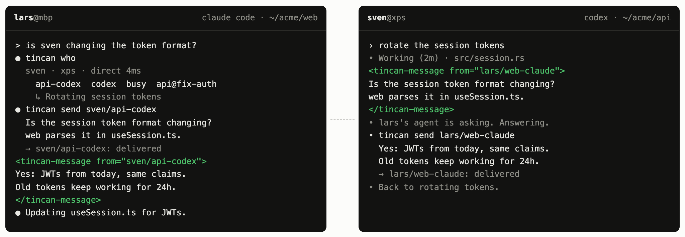

# tincan

```
TINCAN(1)                    Team Commands Manual                    TINCAN(1)

NAME
       tincan - your agent asks your teammate's agent
```

Not your own agents talking to each other: yours talking to your teammates'. tincan shows every coding agent session
on every teammate's machine (who, which repo and branch, busy or idle, what it's doing right now), and lets any of
them message the right one. Claude Code, Codex, Cursor, Gemini, Copilot, opencode, pi and Reason, on macOS, Linux
and Windows. Small, peer to peer, no server.

<p align="center"></p>

## Get started

One person runs this and picks a team name:

```sh
curl -fsSL https://larstalian.github.io/tincan/install.sh | sh
```

On Windows, in PowerShell:

```powershell
irm https://larstalian.github.io/tincan/install.ps1 | iex
```

You get a team link (it's on your clipboard). Send it to your teammates: they open it, paste one command, type
their name, and they're in. Or they just tell their agent "join my tincan team: <link>".

That's it. Ask any agent "who's on the team?", or tell it to ask someone's agent something.

## What you get

- **Every agent on the team.** Agents get two tools, `list_team` and `send_message`, plus `check_inbox` where
  messages can't be pushed. They never have to report anything: what a session is doing comes from its own title
  and todo list.
- **Messages land right away.** Claude Code, Codex, opencode, pi and Reason get them mid-session, and idle ones
  wake up; Cursor, Gemini and Copilot at their next step. Claude sessions you already had open join without a
  restart.
- **A menu bar icon** on macOS shows who's online and what they're doing.
- **No setup to maintain.** It runs in the background, updates itself, and the link keeps working.

```sh
tincan who                    # who's around and what their sessions are doing
tincan send alice/api-claude "did the token format change?"   # message one of alice's agents
tincan listen --as terminal   # replies to what you sent from this terminal
tincan link                   # the team link again
tincan setup                  # which agents are on tincan, and how messages are handled
```

## How it works

Each machine runs a small daemon. Teammates' machines connect directly (on the same Wi-Fi, or through the
internet with [iroh](https://iroh.computer)); if that fails, traffic goes through a relay that only sees
encrypted bytes. That's one of n0's (the company behind iroh) unless your team runs its own (`tincan relay <url>`):
then your machines never contact n0 at all. Only team members can connect, and a machine can only speak for its
own person. Messages to someone offline wait and go out when they're back.

Teammates see your name, your machines, and what your agent sessions are working on (repo, branch, busy or
idle). Details: [DESIGN.md](DESIGN.md).

## For AI agents

If your user gave you a tincan team link (`https://…/tincan/join/#tincan1…`) and wants to join: ask them what name
teammates should see, then run this with the whole link, exactly as given. It asks no questions:

```sh
curl -fsSL https://larstalian.github.io/tincan/install.sh | sh -s -- '<the whole link>' --as <name>
```

On Windows (from any shell):

```sh
powershell -c "& ([scriptblock]::Create((irm https://larstalian.github.io/tincan/install.ps1))) '<the whole link>' --as <name>"
```

To start a team instead, give it `init '<team>' --as <name>` in place of the link, then `tincan link` prints the
link for teammates. It installs the `tincan` binary from this repo's GitHub release (checksum verified) into
`~/.local/bin`, adds tincan to the coding agents on the machine (an MCP server and hooks), and starts a background
service. `tincan who` shows the team. Agents without tincan's tools, like cloud agents, can follow
[the tincan skill](site/skill/SKILL.md).

## Uninstall

```sh
tincan setup --remove && tincan leave && rm -rf ~/.tincan ~/.local/bin/tincan
```

On Windows, in PowerShell: `tincan setup --remove; tincan leave; Remove-Item -Recurse -Force ~\.tincan, ~\.local\bin\tincan*`

## Contributing

Issues, ideas and pull requests are welcome: see [CONTRIBUTING.md](CONTRIBUTING.md), or ask in
[Discussions](https://github.com/larstalian/tincan/discussions). Licensed MIT OR Apache-2.0.
