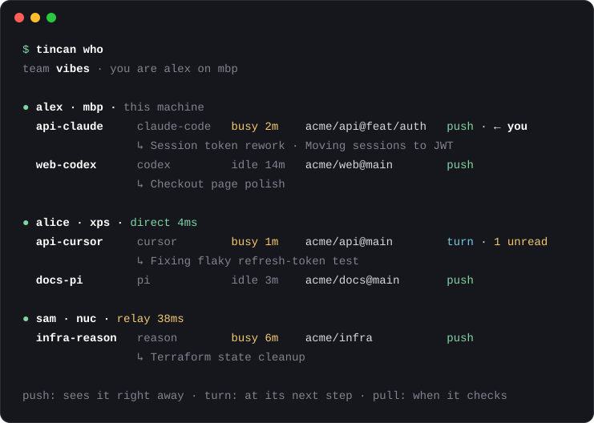

# tincan

<p align="center"></p>

A team directory and message bus for coding agents. Every agent session on every teammate's machine (Claude
Code, Codex, Cursor, Gemini CLI, Copilot CLI, opencode, pi, Reason) can see who is working on what right now, and message
the right session directly: across the LAN or the internet, peer to peer, with no server to run.

<p align="center"></p>

Your agent can then just do `send_message(to="alice/api-cursor", message="I'm changing the token format in
auth/session.rs, heads up")`, and it lands in alice's Cursor session.

**Status:** early. Tested on macOS with real Claude Code and Codex sessions and with two machines; Linux builds
come from CI. Expect rough edges and tell us about them.

## For AI agents

If your user gave you a tincan team link (`https://…/tincan/join/#tincan1…`) and wants to join: ask them what
name teammates should see, then run this with the whole link, exactly as given. It asks no questions:

```sh
curl -fsSL https://asdf9384.github.io/tincan/install.sh | sh -s -- '<the whole link>' --as <name>
```

To start a new team instead: `curl -fsSL https://asdf9384.github.io/tincan/install.sh | sh -s -- init '<team name>' --as <name>`, then `tincan link`
prints the link to send to teammates.

Either way it installs the `tincan` binary from this repo's GitHub release (checksum verified) into `~/.local/bin`,
adds tincan to the coding agents on the machine (an MCP server and hooks), and starts a small background service.
At least one teammate must be online to join. `tincan who` shows the team; `tincan setup --remove` undoes the
agent changes.

## Get started

One person sets up the team, once:

```sh
curl -fsSL https://asdf9384.github.io/tincan/install.sh | sh
```

It asks your name and a team name, puts the coding agents it finds on tincan, and gives you the **team link**
(also on your clipboard). Send it to your friends. The link opens a page with one command; they paste it into
a terminal, type their name, and they're in. The same link works for everyone and keeps working: send it in
the group chat and forget about it. `tincan link` shows it again; `tincan link --new` replaces it (removing
someone replaces it too).

Then ask any of your agents: "who's on the team?" Claude Code sessions that were already open are on it right away
(they take messages through their own socket and reply with the `tincan` CLI); other agents pick it up in new
sessions. Plain `tincan` shows
who's around; `tincan setup` changes which agents are on tincan and how messages are handled.

There's no server and no host: every machine talks to the others directly, and any teammate's machine can let a
newcomer in, so someone just has to be online. Codex asks once to trust the new hooks: choose "Trust all and
continue". Gemini CLI only runs hooks and MCP servers in trusted folders.

Or let your agent do it: tell it "join my tincan team: <link>" (the join page has that line ready to copy).

On a Mac, tincan sits in the menu bar while it runs: two speech bubbles, filled while a teammate is connected,
with the number of messages waiting for you. Its menu lists each machine's sessions and what they're doing,
and copies the team link. "Hide menu bar icon" turns it off (`tincan setup` turns it back on).

## What agents get

| Tool | |
|---|---|
| `list_team` | Every live session: who, which machine, which agent, repo@branch, busy/idle, what it's doing |
| `send_message` | To a session, a person, a whole repo, or everyone (below) |
| `check_inbox` | Read messages, optionally wait for one (a reply, say) |

Agents don't report anything. What a session is doing comes from what its agent records anyway: its title
(Claude Code and Codex name every session) and the task in progress on its todo list. A Claude Code session
you `/rename` keeps that name on tincan.

| Address | Means |
|---|---|
| `alice/api-cursor` | one session (`api-cursor` alone works when the name is unique) |
| `alice/api-cursor@xps` | that session on a specific machine |
| `alice` | alice the person: their human inbox (`tincan inbox`) |
| `alice/*` | all of alice's live sessions |
| `repo:api` | every live session working in a repo |
| `*` | everyone |

Sessions are named `<repo>-<agent>`. A new session in the same place takes over a dead one's name and its
unread mail, so "tell the api agent" keeps working across restarts.

## How messages reach each agent

| Agent | Speed | How |
|---|---|---|
| Claude Code | **push** | Injected into the conversation between tool calls; starts a turn if the session is idle |
| Codex | **push** | `codex queue` (runs after the current turn, or right away when idle); hooks as fallback |
| opencode | **push** | Plugin delivers into idle sessions within seconds |
| pi | **push** | Extension steers it into the running turn, or starts one within seconds when idle. Its tools are deferred: no context until the model looks for them |
| Reason | **push** | `reason session send` (after the current turn). Reason's agent runs in its cloud, so tincan lists your live Reason sessions and it replies with the `tincan` CLI |
| Cursor | turn | Hooks: shown after the next tool call, or as a follow-up when the turn ends |
| Gemini CLI | turn | Hooks: after the next tool call, or when the turn ends |
| Copilot CLI | turn | Hooks: after the next tool call, or when the turn ends |
| any other MCP client | pull | Seen when it calls `check_inbox`; every tool result mentions unread mail |

`send_message` tells the sender which of these applies, so agents know whether to wait for a reply.

## CLI

```sh
tincan who [filter] [--all]        # the directory (filter by person, repo, agent, text)
tincan send <to> <message>         # from you, the human; also `tincan send alice "lunch?"`
tincan inbox [--wait 60]           # your messages
tincan team                        # people, machines, and whether each is direct or relayed
tincan link [--new]                # the team link (or a new one; the old one stops working)
tincan invite --me                 # a one-time four-word code to add another machine of yours
tincan held / approve / reject     # messages waiting for your approval (see policies)
tincan remove <person|machine>     # take someone out of the team
tincan doctor                      # check that everything works
tincan setup                       # choose which agents are on tincan (--remove undoes everything)
tincan leave                       # leave the team on this machine
```

## Trust and privacy

- **Only team machines can connect.** Membership is a list signed by members' machine keys and replicated to
  every machine; connections are authenticated by those keys (QUIC/TLS via [iroh](https://iroh.computer)).
  A machine can only send as its own person.
- **What teammates see:** session names, agent, repo and branch, busy/idle, the `doing` line, and the last
  component of the working directory. Set `share_paths = true` to show full paths.
- **Peer messages are framed as peer input,** never as instructions from the agent's own user. Agents are told
  to treat them like a colleague's request and to check with their user before anything destructive.
- **You decide what gets through** (`~/.tincan/config.toml`):

  ```toml
  [inbound]
  default = "accept"        # or "hold" (you approve with `tincan approve`) or "refuse"

  [inbound.people]
  sam = "hold"
  ```

  Each machine is also limited to 60 messages a minute.
- **The team link** carries the team's join secret and a few members' keys (after the `#`, which browsers never
  send to the server). Anyone holding it can join, so treat it like a group-chat invite; `tincan link --new`
  replaces it. One-time four-word codes (`tincan invite --code`) are for reading out loud or adding your own
  machines.
- **No server of ours.** Machines connect directly (on the LAN, or hole-punched across the internet). When
  that fails, traffic goes through a relay that only sees encrypted bytes: n0's public relays by default, or
  your own with `tincan relay https://relay.example.com` (run [`iroh-relay`](https://docs.iroh.computer/concepts/relays)
  on any small server).

## Config

`~/.tincan/config.toml`:

| Key | Default | |
|---|---|---|
| `person` | `$USER` | your name (set by `init`/`join`) |
| `share_paths` | `false` | show teammates full working directories |
| `share_unmanaged` | `false` | show teammates Claude Code sessions that don't have tincan loaded |
| `tray` | `true` | macOS: show the menu bar icon while the background service runs |
| `lan` | `true` | find teammates on the local network (mDNS) |
| `inbound` | accept | see above |

## Troubleshooting

- **`tincan doctor`** checks the daemon, the team connection (direct or relayed, per machine) and every agent.
- **An agent doesn't have the tincan tools:** restart that session; agents load MCP servers at startup.
- **A teammate shows as offline:** their machine is asleep or tincan isn't running there (`tincan doctor` on
  their side). Messages wait in your outbox and go out when they're back.
- **macOS asks to let tincan find devices on your local network:** allow it for direct LAN connections. If you
  don't, tincan still works over the internet.
- **Codex sessions don't show up until they use a tincan tool:** Codex hasn't been told to trust the hooks yet;
  run `/hooks` in Codex.
- Logs: `~/.tincan/daemon.log`.

## Uninstall

```sh
tincan setup --remove     # unwire every agent, remove the service (edited files keep a .bak-tincan backup)
tincan leave              # leave the team
rm -rf ~/.tincan ~/.local/bin/tincan
```

## How it works

One binary, `tincan`: a daemon per machine (sessions, mailboxes, connections to teammates), an MCP server each
agent launches, hook handlers, and this CLI. See [DESIGN.md](DESIGN.md).

## Development

```sh
cargo test
cargo build && python3 tests/e2e/two_machines.py   # two machines over iroh, simulated agents (needs internet)
python3 tests/e2e/hooks.py                          # Cursor, Gemini, Copilot, opencode hook flows
# Two "machines" by hand:
TINCAN_HOME=/tmp/a TINCAN_MACHINE=laptop TINCAN_NO_MDNS=1 cargo run -- init test --as alex --no-setup
TINCAN_HOME=/tmp/a TINCAN_MACHINE=laptop TINCAN_NO_MDNS=1 cargo run -- invite
TINCAN_HOME=/tmp/b TINCAN_MACHINE=desktop TINCAN_NO_MDNS=1 cargo run -- join tincan1… --as alice --no-setup
```

Releases: push a `v*` tag; GitHub Actions builds macOS and Linux binaries and publishes them with `install.sh`.

## License

MIT OR Apache-2.0
